<div align="center">

<a href="https://deep3d.world">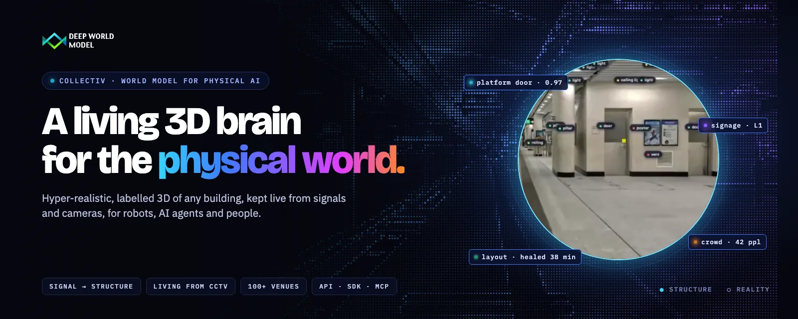</a>

# Every building deserves a brain.

### Deep World Model · The Spatial Brain for the physical world

**We are building the world model for physical AI: a living, real‑time 3D understanding of the world's buildings, grown from ordinary phones and the signals already in the air, that people, robot fleets and AI agents can all query and act on.**

[**Website**](https://deep3d.world) ·
[**Project page**](https://collectiv-co.github.io/deep-world-model) ·
[**Demos**](https://deep3d.world/#demos) ·
[**World models**](#where-dwm-sits-among-world-models) ·
[**Living model**](#a-living-world-model) ·
[**Research**](#science-and-research) ·
[**Team**](#team) ·
[**FAQ**](#faq) ·
[**SDK preview**](#sdk-preview) ·
[**API access**](mailto:info@collectiv.co?subject=Deep%20World%20Model%20API%20access) ·
[**Collectiv**](https://collectiv.co)


</div>

---

> [!NOTE]
> This is the public home of the Deep World Model. **Code, SDKs and model cards are on the way**; watch or star the repo to be notified.

## Mission

> **Give every physical space a living memory that people, robots and AI agents can share.**

## Vision

AI has learned to read, write, see and reason. It still does not know **where it is**.

A language model can plan a journey but cannot see the closed escalator. A delivery robot can walk but not past last night's new hoarding. A digital twin is out of date the morning after it is delivered. Every machine entering the physical world needs the same missing piece: a model of the space that is **true right now**.

We believe that model should be **one shared brain per building**, not a hundred private models. It should be grown from the devices already in people's pockets, grounded in physics rather than guesswork, kept current by everyone who walks through, and open to every robot, agent and app through common standards.

**Our vision is a world where every machine, in every building on Earth, knows where it is, what is around it, and what just changed.**

<table>
<tr>
<td width="33%" valign="top">

#### 🧭 The web indexed information.
#### 💬 Language models learned the world of words.
#### 🧠 World models are learning the physical world.

</td>
<td width="67%" valign="top">

**Why now**

- **AI is moving into the physical world.** Robots, autonomous fleets and AI agents are leaving the lab for airports, stations, hospitals and malls: spaces that change every day.
- **GPS stops at the door.** People spend roughly 90% of their lives inside buildings, where satellite positioning cannot reach. It is the part of the world AI understands least, and the part that goes out of date fastest.
- **Static scans cannot keep up.** A laser scan costs about **$100K and three weeks** per zone and starts going stale the day it is delivered.
- **The signals are already there.** Every building is full of Wi‑Fi, Bluetooth and geomagnetic fields that encode its shape. Every visitor carries a sensor.

</td>
</tr>
</table>

## What the Spatial Brain is

The **Deep World Model (DWM)** turns any building into a living, machine‑readable world model. It:

- **starts from two photos, not two thousand**, by reading the radio and magnetic signals already in the space;
- **heals itself in under an hour**, regenerating only the micro‑zone that changed from a phone or CCTV feed while the building stays open;
- **knows what everything is**: every exit, lift, gate, sign and clearance limit is labelled, measured and placed;
- **speaks to machines**, exposing geometry, semantics, routing and a change feed through one API and MCP‑style agent tools.

<table>
<tr>
<td align="center" width="20%"><h3>35B</h3><sub>parameter spatial‑semantic model</sub></td>
<td align="center" width="20%"><h3>~1,200</h3><sub>semantic base classes</sub></td>
<td align="center" width="20%"><h3>3 cm / 5 cm</h3><sub>geometry / semantic resolution, priority zones</sub></td>
<td align="center" width="20%"><h3>&lt;10 h</h3><sub>to model a 170,000 m² terminal in live operation</sub></td>
<td align="center" width="20%"><h3>&lt;1 h</h3><sub>micro‑zone self‑healing</sub></td>
</tr>
</table>

<table>
<tr>
<td width="50%">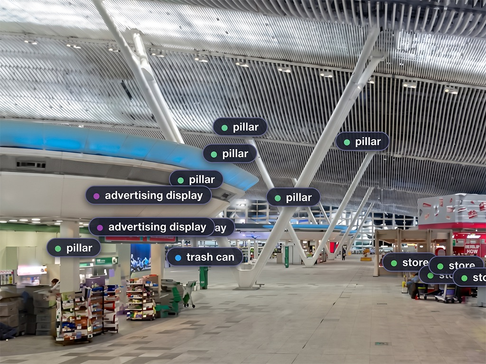</td>
<td width="50%">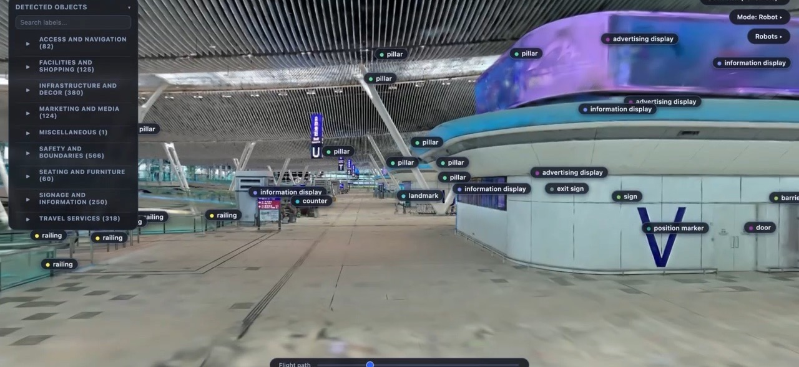</td>
</tr>
<tr>
<td><sub><b>Semantic layer.</b> Pillars, displays, stores and bins found and named in a reconstructed terminal.</sub></td>
<td><sub><b>A major international airport, departure hall.</b> Live viewer with detected objects by category, robot mode and occlusion.</sub></td>
</tr>
</table>

## Live, not a concept

**100+** venues modelled and live · **5M+** people a day move through spaces the model sees · **1.7B+** journeys a year

The Spatial Brain already runs inside some of the most demanding, most visited spaces in Asia:

| Sector | Who | Scale |
|---|---|---|
| ✈️ **Aviation** | One of the world's busiest international airports | 170,000 m² terminal modelled in under 10 hours, during full passenger operations |
| 🚇 **Rail** | One of the world's largest metro operators, and the pioneer of the "rail + property" model that builds cities on top of stations | 99 stations, 1M+ daily riders |
| 🚄 **High‑speed rail** | A cross‑border high‑speed rail terminus | Multi‑level underground terminus |
| 🎭 **Culture** | One of the world's largest cultural districts | Flagship performing‑arts venue, step‑by‑step reconstruction |
| 🎓 **Campus** | A globally top‑ranked research university | Full campus |
| 🏨 **Integrated resorts** | A global integrated‑resort leader | 5 resort properties on Asia's leading resort strip |
| 🛍️ **Retail** | A landmark harbourfront mall beneath one of Asia's tallest towers, and a megamall above a major airport‑rail interchange | Multi‑level retail |
| 🛡️ **Public safety** | A city government's smart‑patrolling programme | City‑scale patrol routes |

## Where DWM sits among world models

> **A world model of the real world.**

World models are AI's next frontier: an internal picture of the world that lets machines predict, plan and act. Most are generative, trained on video to imagine plausible worlds. Physical AI also needs the other half: a model of the actual places it works in, measured, labelled and current. The Deep World Model is the **world's first real‑time 3D world model for complex physical infrastructure**.

| | Generative world models | Static digital twins | **Deep World Model** |
|---|---|---|---|
| Models | Plausible, imagined worlds | One building, as surveyed | **Real buildings, as they are right now** |
| Learns from | Internet‑scale video | Laser scans and BIM files | **Phones, ambient Wi‑Fi, BLE and geomagnetic signals, existing CCTV** |
| Grounding | Pixels, so it can hallucinate | Survey geometry | **Signal‑first: geometry anchored to physical measurement** |
| Stays current | Not tied to any real place | Stale within days | **Self‑heals changed micro‑zones in under an hour** |
| Knows what things are | Implicitly | Geometry only, or hand‑tagged | **~1,200 semantic classes, voxel‑level** |
| Built for | Simulating and training agents | Design and facilities records | **Robots, AI agents and people acting in real buildings** |

<table>
<tr>
<td width="25%" valign="top"><sub><b>🥇 WORLD'S FIRST</b></sub><br><b>Real‑time 3D world model for complex infrastructure</b><br><sub>Live across 100+ venues: airports, metro and high‑speed rail, campuses, resorts and malls.</sub></td>
<td width="25%" valign="top"><sub><b>🥇 WORLD'S FIRST</b></sub><br><b>Signal‑first multimodal grounding</b><br><sub>Ambient Wi‑Fi, BLE and geomagnetic signals fused with vision, so pure‑vision hallucination drops sharply.</sub></td>
<td width="25%" valign="top"><sub><b>🥇 WORLD'S FIRST</b></sub><br><b>Localised voxel patching</b><br><sub>Partial updates touch only the altered micro‑zone, from an ordinary phone or an existing CCTV feed.</sub></td>
<td width="25%" valign="top"><sub><b>⚡ WORLD'S FASTEST</b></sub><br><b>Micro‑zone self‑healing</b><br><sub>A changed zone regenerated in under an hour, building open. A 170,000 m² terminal modelled in under 10 hours.</sub></td>
</tr>
</table>

**Four layers, two moats.** 3D geometry is becoming a commodity. Knowing what every voxel is (**semantics**) and keeping it in sync with reality (**currency**) is the real moat, exposed to every robot, agent and app through one **universal agentic API**.

| Layer | Role | What it means |
|---|---|---|
| 1 · 3D geometry | Commodity | Becoming table stakes |
| 2 · Semantics | **Moat** | Knowing what every voxel is |
| 3 · Currency | **Moat** | Staying in sync with reality |
| 4 · Universal agentic API | Interface | One brain for every robot, agent and app |

Generative world models teach machines what the world *could* look like. The Deep World Model tells them what it looks like **right now**, and gives simulation and training real ground truth to start from.

## How it works: Signal‑to‑Structure

Most 3D capture starts with pixels. DWM starts with **physics**: the radio signals that fill every building already encode its walls, openings and scale. Vision is layered on top, so the reconstruction rests on measurement rather than guesswork, and pure‑vision hallucinations drop sharply.

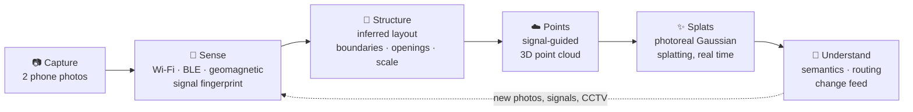

<table>
<tr>
<td align="center" width="25%">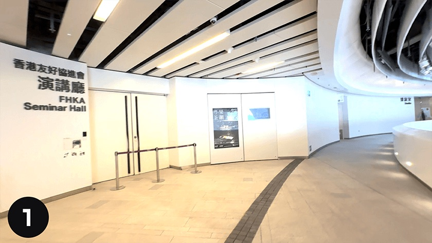<br><sub><b>01 Capture</b><br>Two ordinary photos</sub></td>
<td align="center" width="25%">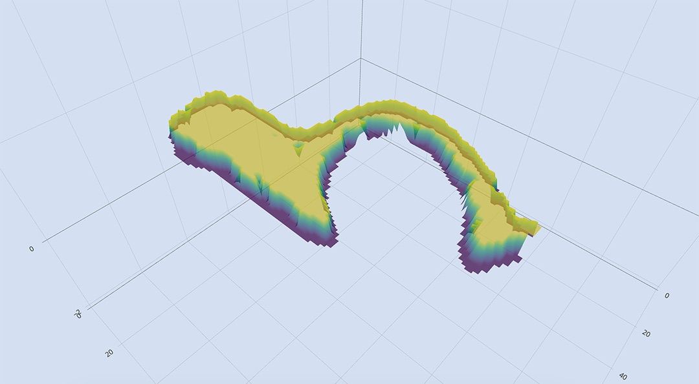<br><sub><b>02 Sense</b><br>The signal fingerprint</sub></td>
<td align="center" width="25%">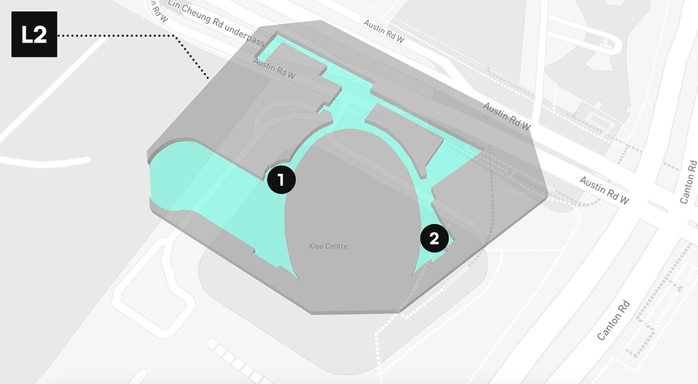<br><sub><b>03 Structure</b><br>Layout, inferred from signals</sub></td>
<td align="center" width="25%">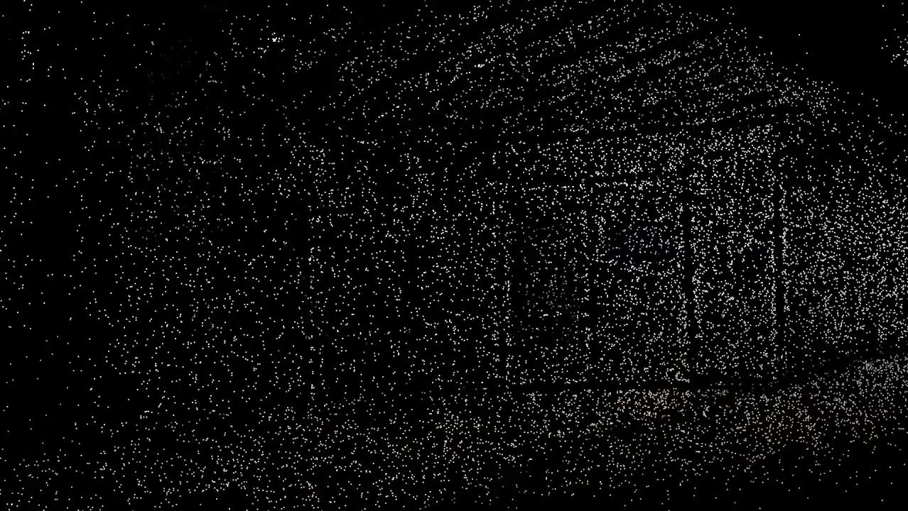<br><sub><b>04 Points</b><br>Signal‑guided point cloud</sub></td>
</tr>
</table>
<p align="center"><sub>Real capture at a flagship performing‑arts venue. Steps 05–06 render the cloud as Gaussian splats and label every object.</sub></p>

## Six properties of the Spatial Brain

| | Capability | What it means |
|---|---|---|
| 📡 | **Signal‑first grounding** | Fuses ambient Wi‑Fi, BLE and geomagnetic fields with vision, so geometry is anchored to physical measurement. |
| ♻️ | **Micro‑zone self‑healing** | Detects a local change from a phone or CCTV feed and regenerates only that zone in under an hour. No full rescan. |
| 👥 | **Zero‑downtime capture** | Built from everyday phones and crowd motion during normal hours. Zero closures, zero laser rigs. Crowdsourced through the [Beetle](https://deep3d.world/#beetle) app. |
| 🏷️ | **Machine‑readable world** | Knows what every voxel is: exits, fare gates, clearance limits, step‑free paths. Vertical heads pretrained for aviation, rail, campus, retail and government. |
| 🤖 | **One brain for every agent** | Natural‑language spatial query and routing for staff and AI agents, exposed as MCP‑style tools for planning and lookup. |
| 🔌 | **Open fleet standards** | VDA 5050 and Open‑RMF for fleets, OpenUSD for 3D, ROS 2 for motion. One shared world model instead of ten vendor silos. |


## A living world model

> **Most 3D models are memories. Ours is alive.**

A scan records how a building looked on the day of the survey. The Deep World Model keeps watching. **The CCTV cameras a venue already runs become its eyes.** Each camera is registered into the model, each frame is checked against what the model expects to see, and only the part that changed is rebuilt. The building stays open and the world model stays current.

| Layer | What it holds | How fast it updates |
|---|---|---|
| **Structure** | Walls, floors, columns, stairs | Rarely: built once from signals and phones, rebuilt on renovation |
| **Layout** | Kiosks, barriers, signage, seating, queues | **Under an hour**: partial update of the affected micro‑zone from CCTV |
| **Activity** | People flow, crowd density, occupancy | **Live**: an anonymous layer streamed on top of the geometry |


<table>
<tr>
<td width="50%">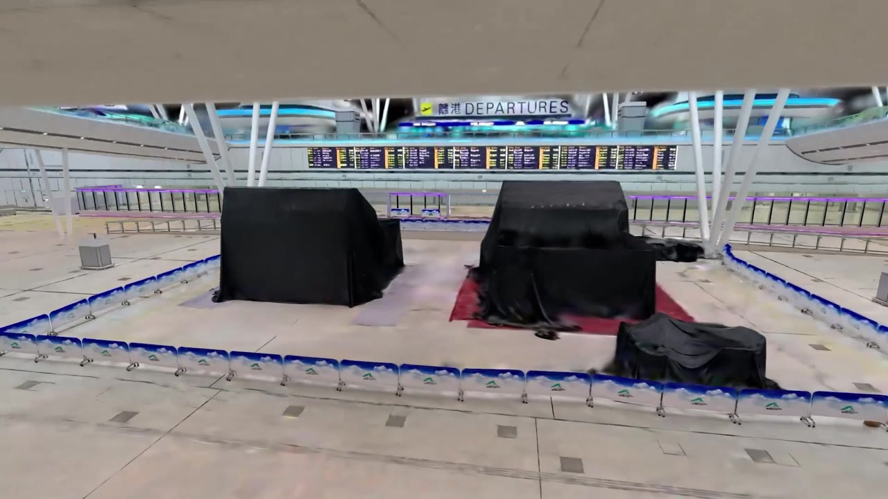</td>
<td width="50%">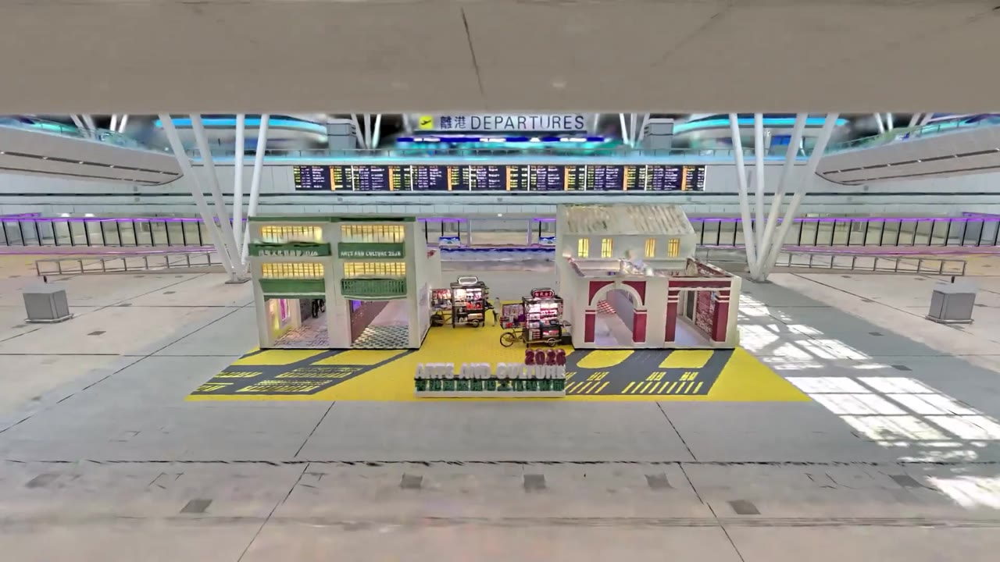</td>
</tr>
<tr>
<td align="center"><sub><b>Before</b> · captured</sub></td>
<td align="center"><sub><b>After</b> · only the changed micro‑zone regenerated, building open</sub></td>
</tr>
</table>

## Static scans vs. a living model

| | Static scan / BIM | **Deep World Model** |
|---|---|---|
| Capture | Laser rigs, survey crew, closures | **2 phone photos + ambient signals** |
| Time to refresh a zone | ~3 weeks | **Under an hour** |
| Cost to refresh a zone | ~$100K | **Marginal** (crowdsourced) |
| Currency | Stale within days | **Self‑healing, continuously current** |
| Live sensing | None | **Existing CCTV, registered into the model** |
| Semantics | Geometry only, or hand‑tagged | **~1,200 classes, voxel‑level** |
| Machine access | Files to download and convert | **Live API, change feed, agent tools** |
| Over time | Decays | **Grows in accuracy and semantic value** |

## Science and research

**Built by Collectiv. Sharpened by open research.**

The Deep World Model is designed, built and run by the Collectiv team. That includes its architecture, the spatial‑semantic model, the Signal‑to‑Structure pipeline, micro‑zone self‑healing and the production system live across 100+ venues.

Alongside this work, Collectiv's **co‑founder and Chief Scientist, Professor S.‑H. Gary Chan** (Professor, Department of Computer Science and Engineering, The Hong Kong University of Science and Technology; Associate Director, GREAT Smart Cities Institute), and his Smart IoT and Sensing Systems Group at HKUST publish academic research in areas the model touches: ambient‑signal positioning, learning from unlabelled crowd data, people sensing from video and camera‑based 3D localisation.

### Research behind the ideas

Selected figures from Professor Chan's peer‑reviewed research, shown next to the parts of the Deep World Model they relate to. They illustrate the science around the problems we work on. The Deep World Model, its methods and its production system are Collectiv's own engineering, and may differ from what is published.

<table>
<tr>
<td width="44%"><a href="docs/assets/research/ubifin.jpg">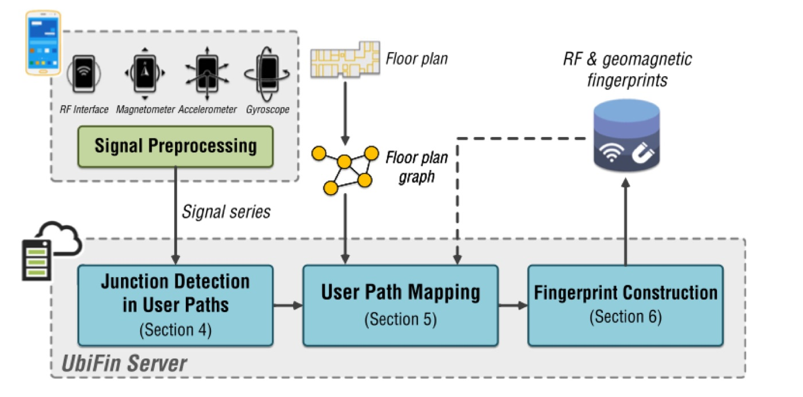</a></td>
<td><sub><b>01 · CAPTURE</b></sub><br><a href="https://cse.hkust.edu.hk/~gchan/papers/TMC23_ubifin.pdf"><b>Implicit Multimodal Crowdsourcing for Joint RF and Geomagnetic Fingerprinting</b></a><br><sub>Fig. 1 · Tan et al., IEEE TMC 2023</sub><br><br><b>In the paper.</b> Phones' RF, magnetometer, accelerometer and gyroscope streams are mapped onto a floor-plan graph to build RF and geomagnetic fingerprints, with no one labelling anything.<br><br>🧠 <b>Why it matters to us.</b> Related to how we approach capture: everyday phones, ambient signals first, pixels second.</td>
</tr>
<tr>
<td width="44%"><a href="docs/assets/research/leto.jpg">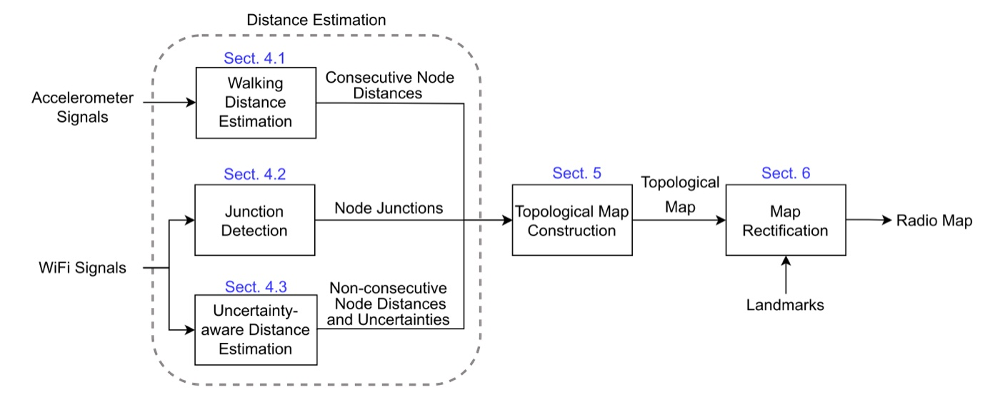</a></td>
<td><sub><b>01 · CAPTURE</b></sub><br><a href="https://cse.hkust.edu.hk/~gchan/papers/TMC24_leto.pdf"><b>Leto: Crowdsourced Radio Map Construction with Learned Topology and A Few Landmarks</b></a><br><sub>Fig. 2 · Wang et al., IEEE TMC 2024</sub><br><br><b>In the paper.</b> Accelerometer and Wi‑Fi traces from ordinary walkers, plus a handful of landmarks, are turned into a full radio map through learned topology.<br><br>🧠 <b>Why it matters to us.</b> Shares an idea behind Signal‑to‑Structure: crowd traces as low‑cost anchors in place of a site survey.</td>
</tr>
<tr>
<td width="44%"><a href="docs/assets/research/grafics.jpg">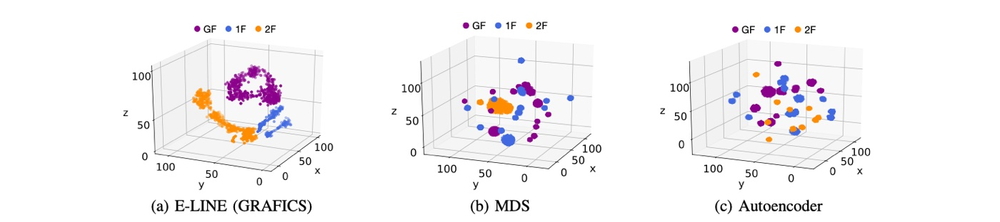</a></td>
<td><sub><b>02 · STRUCTURE</b></sub><br><a href="https://cse.hkust.edu.hk/~gchan/papers/ICDCS22_GRAFICS.pdf"><b>GRAFICS: Graph Embedding-based Floor Identification Using Crowdsourced RF Signals</b></a><br><sub>Fig. 6 · Zhuo et al., IEEE ICDCS 2022</sub><br><br><b>In the paper.</b> Graph embeddings of crowdsourced RF samples separate cleanly by floor (a), where MDS and autoencoder baselines blur together (b, c).<br><br>🧠 <b>Why it matters to us.</b> Relevant to a problem we also face: placing crowd samples and photos on the right floor of a multi‑level venue.</td>
</tr>
<tr>
<td width="44%"><a href="docs/assets/research/sitebuilder.jpg">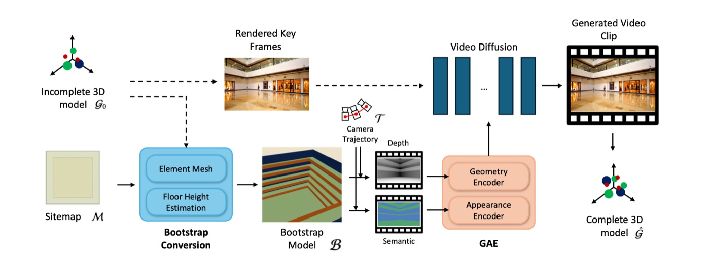</a></td>
<td><sub><b>02 · STRUCTURE</b></sub><br><a href="https://cse.hkust.edu.hk/~gchan/papers/MM26_SiteBuilder.pdf"><b>SiteBuilder: Sitemap-Grounded 3D Completion for Atrium Scene</b></a><br><sub>Fig. 2 · Song &amp; Chan, ACM Multimedia 2026</sub><br><br><b>In the paper.</b> A sitemap is lifted into a bootstrap mesh, and depth and semantic conditions then guide video diffusion to complete a multi‑storey atrium in 3D.<br><br>🧠 <b>Why it matters to us.</b> Explores a challenge close to ours: completing large atria and concourses consistently across levels.</td>
</tr>
<tr>
<td width="44%"><a href="docs/assets/research/3dfa.jpg">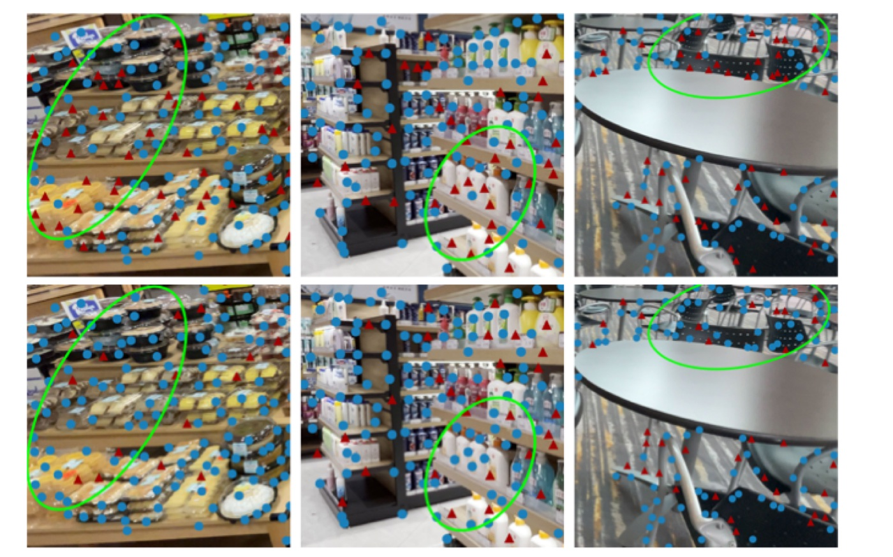</a></td>
<td><sub><b>03 · LIVING</b></sub><br><a href="https://cse.hkust.edu.hk/~gchan/papers/CVPRF26_3DFA.pdf"><b>3DFA: Aligning the Features Between Point Cloud and Query Image for Scene-Specific Visual Localization</b></a><br><sub>Fig. 6 · Song et al., CVPR 2026 Findings</sub><br><br><b>In the paper.</b> 2D image features are aligned directly with the 3D point cloud. Ambiguous matches (red triangles, ellipses) become correct ones (blue).<br><br>🧠 <b>Why it matters to us.</b> Closely related to the first step of the living loop: estimating where a camera sits inside a 3D model.</td>
</tr>
<tr>
<td width="44%"><a href="docs/assets/research/sweeploc.jpg">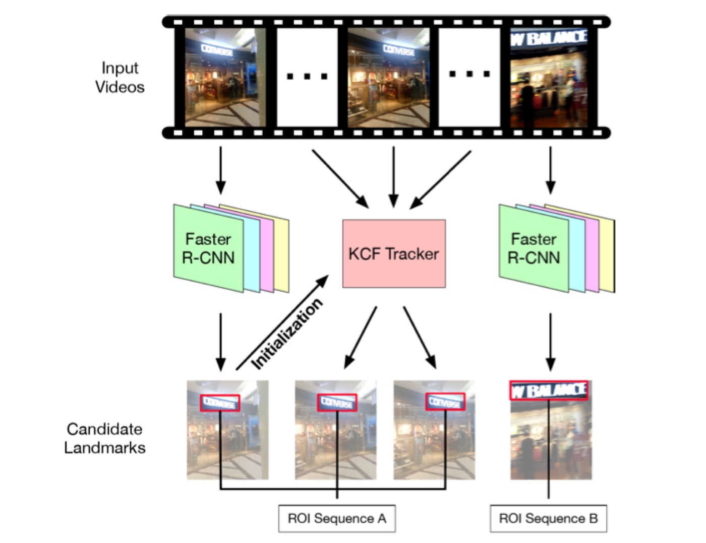</a></td>
<td><sub><b>03 · LIVING</b></sub><br><a href="https://cse.hkust.edu.hk/~gchan/papers/IMWUT18_sweeploc.pdf"><b>SweepLoc: Automatic Video-based Indoor Localization by Camera Sweeping</b></a><br><sub>Fig. 3 · Li et al., ACM IMWUT 2018</sub><br><br><b>In the paper.</b> Faster R‑CNN detects landmarks in video, and a KCF tracker follows them across frames, so only key frames need full detection.<br><br>🧠 <b>Why it matters to us.</b> An early example of the detect‑and‑track pattern for turning video into named, placed objects.</td>
</tr>
<tr>
<td width="44%"><a href="docs/assets/research/gufu.jpg">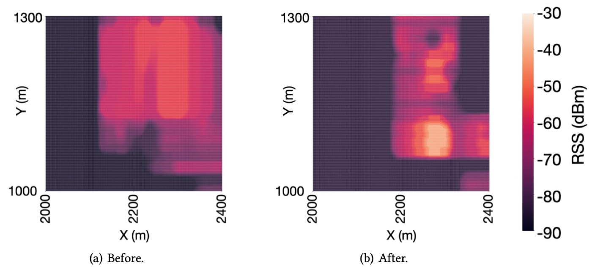</a></td>
<td><sub><b>03 · LIVING</b></sub><br><a href="https://cse.hkust.edu.hk/~gchan/papers/IMWUT25_GUFU.pdf"><b>Graph-based Fingerprint Update Using Unlabelled WiFi Signals</b></a><br><sub>Fig. 1 · Chiu et al., ACM IMWUT 2025</sub><br><br><b>In the paper.</b> The same access point's signal map on a campus, two months apart. Buildings change, signals drift, and a map built once goes stale.<br><br>🧠 <b>Why it matters to us.</b> Illustrates why a spatial model has to keep updating: physical signals drift as buildings change.</td>
</tr>
<tr>
<td width="44%"><a href="docs/assets/research/mpcount.jpg">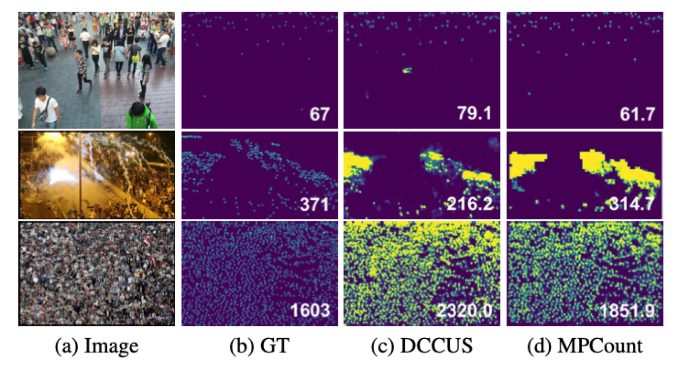</a></td>
<td><sub><b>04 · ACTIVITY</b></sub><br><a href="https://cse.hkust.edu.hk/~gchan/papers/CVPR24_SDG.pdf"><b>Single Domain Generalization for Crowd Counting</b></a><br><sub>Fig. 5 · Peng &amp; Chan, CVPR 2024</sub><br><br><b>In the paper.</b> Crowd density maps on domains never seen in training. MPCount's counts stay close to ground truth where a prior method overshoots.<br><br>🧠 <b>Why it matters to us.</b> Relevant to the activity layer: estimating crowd density from cameras in unfamiliar venues.</td>
</tr>
</table>
<sub>Figures reproduced from the cited publications for reference and commentary · © the respective authors and publishers · Inclusion does not imply that the Deep World Model implements the published method</sub>

### Selected publications

#### Signals: Ambient signals → structure
Research on grounding location in physical measurement: Wi‑Fi, BLE and geomagnetic maps built from crowds and kept current without a site survey.

- [Leto: Crowdsourced Radio Map Construction with Learned Topology and A Few Landmarks](https://cse.hkust.edu.hk/~gchan/papers/TMC24_leto.pdf). Y. Wang, K.-S. Wong, **S.-H. Chan**, W. Mow. *IEEE TMC 2024*.
- [Graph-based Fingerprint Update Using Unlabelled WiFi Signals](https://cse.hkust.edu.hk/~gchan/papers/IMWUT25_GUFU.pdf). K. Chiu, H. Yin, W. Zhuo, C.-H. Lee, **S.-H. Chan**. *ACM IMWUT 2025*.
- [Implicit Multimodal Crowdsourcing for Joint RF and Geomagnetic Fingerprinting](https://cse.hkust.edu.hk/~gchan/papers/TMC23_ubifin.pdf). J. Tan, H. Wu, K.-H. Chow, **S.-H. Chan**. *IEEE TMC 2023*.
- [SiFu: A Generic and Robust Multimodal Signal Fusion Platform for Pervasive Localization](https://cse.hkust.edu.hk/~gchan/papers/IoTJ23_SiFu.pdf). M. Wong, Q. Lu, **S.-H. Chan**. *IEEE IoT‑J 2023*.
- [DeepNavi: A Deep Signal-Fusion Framework for Accurate and Applicable Indoor Navigation](https://cse.hkust.edu.hk/~gchan/papers/IMWUT19_DeepNavi.pdf). Q. Niu, N. Liu, J. Huang, Y. Luo, S. He, T. He, **S.-H. Chan**, X. Luo. *ACM IMWUT 2019*.

#### AI: Learning from unlabelled crowds
Research on learning from messy, unlabelled, crowd‑sourced data and transferring to venues not seen before.

- [GRAFICS: Graph Embedding-based Floor Identification Using Crowdsourced RF Signals](https://cse.hkust.edu.hk/~gchan/papers/ICDCS22_GRAFICS.pdf). W. Zhuo, Z. Zhao, K. Chiu, S. Li, S. Ha, C.-H. Lee, **S.-H. Chan**. *IEEE ICDCS 2022*.
- [FIS-ONE: Floor Identification System with One Label for Crowdsourced RF Signals](https://cse.hkust.edu.hk/~gchan/papers/ICDCS23_FIS-1.pdf). W. Zhuo, K. Chiu, J. Chen, Z. Zhao, **S.-H. Chan**, S. Ha, C.-H. Lee. *IEEE ICDCS 2023*.
- [Target-agnostic Source-free Domain Adaptation for Regression Tasks](https://cse.hkust.edu.hk/~gchan/papers/ICDE24_TASFAR.pdf). T. He, Z. Xia, J. Chen, H. Li, **S.-H. Chan**. *IEEE ICDE 2024*.
- [MTM: A Multi-Scale Token Mixing Transformer for Irregular Multivariate Time Series Classification](https://cse.hkust.edu.hk/~gchan/papers/KDD25_MTM.pdf). S. Zhong, W. Zhuo, S. Song, G. Li, Z. Yu, **S.-H. Chan**. *ACM SIGKDD 2025*.

#### People & objects: Sensing the activity layer
Research on sensing people and activity: how many, where, and how they move, from video and from the devices they carry.

- [Single Domain Generalization for Crowd Counting](https://cse.hkust.edu.hk/~gchan/papers/CVPR24_SDG.pdf). Z. Peng, **S.-H. Chan**. *IEEE/CVF CVPR 2024*.
- [CounTr: An End-to-End Transformer Approach for Crowd Counting and Density Estimation](https://cse.hkust.edu.hk/~gchan/papers/ECCV22_CounTr.pdf). H. Bai, H. He, Z. Peng, T. Dai, **S.-H. Chan**. *ECCV 2022 Workshops*.
- [Self-Supervised Association of Wi-Fi Probe Requests Under MAC Address Randomization](https://cse.hkust.edu.hk/~gchan/papers/TMC23_cappuccino.pdf). T. He, J. Tan, **S.-H. Chan**. *IEEE TMC 2023*.
- [DeMo: Experiences of Deploying a Large-Scale Indoor Delivery Monitoring System](https://cse.hkust.edu.hk/~gchan/papers/TMC25_DeMo.pdf). X. Fan, Z. Lin, Y. Hu, Z. Hong, T. Jiang, F. Qian, Z. Yin, **S.-H. Chan**, D. Wu. *IEEE TMC 2025*.

#### Video & 3D: Cameras that know where they are
Research on registering images and video into 3D and on completing missing geometry.

- [3DFA: Aligning the Features Between Point Cloud and Query Image for Scene-Specific Visual Localization](https://cse.hkust.edu.hk/~gchan/papers/CVPRF26_3DFA.pdf). S. Song, Y. Chi, S. Zhong, **S.-H. Chan**. *CVPR 2026 Findings*.
- [SiteBuilder: Sitemap-Grounded 3D Completion for Atrium Scene](https://cse.hkust.edu.hk/~gchan/papers/MM26_SiteBuilder.pdf). S. Song, **S.-H. Chan**. *ACM Multimedia 2026*.
- [SweepLoc: Automatic Video-based Indoor Localization by Camera Sweeping](https://cse.hkust.edu.hk/~gchan/papers/IMWUT18_sweeploc.pdf). M. Li, N. Liu, Q. Niu, C. Liu, **S.-H. Chan**, C. Gao. *ACM IMWUT 2018*.
- [VILL: Towards Efficient and Automatic Visual Landmark Labeling](https://cse.hkust.edu.hk/~gchan/papers/ToSN23_VILL.pdf). Q. Niu, K. Zhu, S. He, S. Cen, **S.-H. Chan**, N. Liu. *ACM TOSN 2023*.
- [Resource-efficient and Automated Image-based Indoor Localization](https://cse.hkust.edu.hk/~gchan/papers/ToSN19_HAIL.pdf). Q. Niu, M. Li, S. He, C. Gao, **S.-H. Chan**, X. Luo. *ACM TOSN 2019*.

Full list: [Prof. Chan's publications](https://cse.hkust.edu.hk/~gchan/garypub.html)

## For builders: one model, every machine can ask it

| Surface | You get |
|---|---|
| **Geometry** | Gaussian splats, point clouds and meshes for any level, at the resolution you need |
| **Semantics** | Every door, lift, sign and exit, named, measured and placed |
| **Routing** | Step‑free, robot‑safe or fastest paths on true geometry |
| **Change feed** | Subscribe to what moved, so fleets and agents never act on a stale world model |
| **Live cameras** | Register existing CCTV so the model keeps itself current |

<details open>
<summary><b>API preview</b> <sub>(illustrative shapes; access is by invitation)</sub></summary>

```http
POST /v1/spaces/airport-t2/route
{ "from": "you", "to": "gate-23", "profile": "step-free" }
```
```json
{
  "distance_m": 214,
  "eta_s": 240,
  "legs": ["lift-A", "east-pier"],
  "avoids": ["stairs-E2"]
}
```

```http
GET /v1/spaces/harbour-mall/changes?since=2026-11-18T00:00Z
```
```json
{
  "changes": [
    { "zone": "L3-atrium", "kind": "hoarding_added", "area_m2": 18.5, "source": "beetle", "confidence": 0.94 },
    { "zone": "L1-east",   "kind": "kiosk_moved",    "shift_m": 3.2,  "confidence": 0.88 }
  ]
}
```
</details>

<details>
<summary><b>More: geometry and semantics endpoints</b></summary>

```http
GET /v1/spaces/arts-centre/levels/L2/model?format=splat
```
```json
{
  "space": "arts-centre", "level": "L2", "format": "gaussian-splat",
  "updated": "2026-11-18T09:42:10Z", "bounds_m": [86.4, 52.1, 9.8],
  "splats": 4180233, "url": "https://…/arts-centre/L2.splat"
}
```

```http
GET /v1/spaces/airport-t2/objects?near=412.3,88.0&radius=25
```
```json
{
  "objects": [
    { "type": "lift", "id": "lift-A", "level": "L6", "door_width_m": 1.4, "step_free": true },
    { "type": "exit", "id": "exit-W", "level": "L7", "clear": true },
    { "type": "sign", "text": "Gates 20-29", "level": "L7" }
  ]
}
```
</details>

### SDK preview

Python, TypeScript, ROS 2, an MCP server for AI agents, and a CLI, all on the same live model. <sub>Preview of the surface shipping into this repo; interfaces may change.</sub>

<details open>
<summary><b><code>quickstart.py</code></b> · Open a space, query objects, plan a route</summary>

```python
# quickstart.py · open a space, ask it questions, plan a route
from dwm import Client

dwm = Client()                       # reads DWM_API_KEY from the environment
space = dwm.spaces.get("airport-t2")

level = space.level("L7")
print(level.summary())
# Level L7 · 38,600 m² · 1,184 object classes · updated 41 s ago

# Every object is named, measured and placed
gates = level.objects(kind="boarding_gate", status="open")
lifts = level.objects(kind="lift", step_free=True)

# Route on true geometry, not a floor-plan guess
route = space.route(
    start=level.point(x=12.4, y=-3.1),
    goal=gates.nearest(to="security_exit_C"),
    profile="step_free",             # or "robot_safe", "fastest"
)
print(f"{route.length_m:.0f} m · {route.eta_s // 60} min · {len(route.turns)} turns")

# Ask in plain language
answer = space.ask("Nearest quiet seating to gate 23 with a power outlet?")
for place in answer.places[:3]:
    print(place.name, place.distance_m, place.confidence)
```
</details>

<details open>
<summary><b><code>live_cctv.py</code></b> · Turn existing CCTV into a living model</summary>

```python
# live_cctv.py · turn the cameras a venue already has into a living model
import asyncio
from dwm import Client
from dwm.live import Camera

dwm = Client()
space = dwm.spaces.get("metro-central")

async def main():
    # 1 · Register once. The pose is solved from the camera's own footage.
    cam = await space.cameras.register(
        Camera(id="cctv-L1-014", stream="rtsp://10.0.4.21/stream1"),
        hint_level="L1",
    )
    print(cam.pose)            # 6-DoF pose in model coordinates
    print(cam.reprojection_px) # 1.4

    # 2 · Watch. Frames are compared with what the model expects to see.
    #     People and passing motion are filtered; only persistent change counts.
    await space.live.enable(
        cameras="all",
        layers=["layout", "occupancy"],
        privacy="edge",        # frames stay on-site; geometry and counts leave
    )

    # 3 · React. Only the changed micro-zone is regenerated and versioned.
    async for change in space.changes.stream(kinds=["layout"]):
        print(change.zone, change.kind, change.area_m2, change.model_version)
        # L1-east  barrier_added  6.4  v2026.11.23-1412

asyncio.run(main())
```
</details>

<details>
<summary><b><code>agent.ts</code></b> · Give an AI agent spatial tools</summary>

```ts
// agent.ts · give any AI agent spatial awareness
import { DWM } from "@collectiv/dwm";
import { runAgent } from "./your-agent"; // any tool-calling LLM agent

const dwm = new DWM({ apiKey: process.env.DWM_API_KEY });
const space = await dwm.spaces.get("harbour-mall");

// Expose the live model as tools the agent can call
const tools = space.asTools(["locate", "route", "objects", "occupancy", "changes"]);

const reply = await runAgent({
  tools,
  prompt:
    "A visitor in a wheelchair is at the north entrance. " +
    "Find the least crowded step-free route to the cinema on L4.",
});

console.log(reply.text);
// Take lift B in the north atrium to L4, then 85 m along the east promenade.
// Crowd density on this route is low. Escalator 3 is closed for maintenance.
```
</details>

<details>
<summary><b><code>robot_nav.py</code></b> · Keep a robot's world model in sync (ROS 2)</summary>

```python
# robot_nav.py · a ROS 2 node that navigates on the live model
import rclpy
from rclpy.node import Node
from dwm.ros import LiveMapBridge

class ServiceRobot(Node):
    def __init__(self):
        super().__init__("service_robot")
        # Publishes /dwm/map and /dwm/keepout, refreshed whenever the model changes
        self.bridge = LiveMapBridge(
            self, space="airport-t2", level="L7",
            frame_id="map", resolution=0.05, profile="robot_safe",
        )
        self.bridge.on_change(self.replan)

    def replan(self, change):
        self.get_logger().info(f"{change.zone}: {change.kind}, replanning")
        self.bridge.request_route(goal="gate_23", avoid=["crowd_density>0.6"])

def main():
    rclpy.init()
    rclpy.spin(ServiceRobot())

if __name__ == "__main__":
    main()
```
</details>

<details>
<summary><b><code>mcp.json</code></b> · Plug the model into any MCP client</summary>

```json
{
  "mcpServers": {
    "deep-world-model": {
      "command": "npx",
      "args": ["-y", "@collectiv/dwm-mcp"],
      "env": {
        "DWM_API_KEY": "<your key>",
        "DWM_SPACE": "airport-t2"
      }
    }
  }
}
```
</details>

<details>
<summary><b><code>terminal</code></b> · The `dwm` command‑line tool</summary>

```console
$ pip install deep-world-model
$ dwm login
✓ Authenticated
$ dwm spaces list
ID              SECTOR     LEVELS  UPDATED
airport-t2      aviation   4       41 s ago
metro-central   rail       3       2 min ago
harbour-mall    retail     6       5 min ago
arts-centre     culture    5       1 h ago
$ dwm export airport-t2 --level L7 --format usd -o t2_L7.usdz
⠿ Streaming 3.98M splats + 1,184 classes … done (14.2 s)
✓ Wrote t2_L7.usdz
$ dwm changes metro-central --follow
14:12:07  L1-east    barrier_added   6.4 m²   conf 0.94   cctv-L1-014
14:13:41  L1-gates   kiosk_moved     3.2 m    conf 0.88   cctv-L1-009
```
</details>

## What becomes possible

- **Airports that run themselves better.** Task dispatch that knows where every staff member, robot and asset is; queue and late‑passenger forecasting; energy heatmaps on true geometry.
- **Transit that is accessible by default.** Step‑free routing, live lift and gate status, robot patrols on a world model that matches tonight's hoarding.
- **Safer public spaces.** Smart patrolling, emergency egress and asset management on a live, labelled model.
- **Robots that work anywhere on day one.** A shared, standards‑based world model for heterogeneous fleets, so no vendor has to build its own.
- **AI agents that can act, not just answer.** "Where is the nearest step‑free route to Gate 23?" answered from the building itself.

## From one building to every building

| Horizon | What it looks like |
|---|---|
| **Today** | 100+ venues live across some of Asia's busiest airports, rail networks, campuses, resorts and malls |
| **Next** | Every major airport, station and campus: SDKs, an MCP server and open exporters so any robot or agent can plug in |
| **Ultimately** | A planet‑scale, continuously updated world model of the built environment: the ground truth physical AI runs on |

## Team

> **Shipped to a whole city. Now, every building.**

Twenty years of location intelligence across Hong Kong and Macao is what the Deep World Model stands on. 20+ specialists in signal processing, graph neural networks, machine learning, location intelligence and generative AI, with city‑scale deployments behind them.

<table>
<tr>
<td align="center" width="25%"><h3>9.5M+</h3><sub>downloads of Hong Kong's citywide contact‑tracing app, in a city of 7.5M people</sub></td>
<td align="center" width="25%"><h3>99</h3><sub>metro stations with inclusive in‑station navigation</sub></td>
<td align="center" width="25%"><h3>5</h3><sub>integrated resorts with venue‑wide navigation on Asia's leading resort strip</sub></td>
<td align="center" width="25%"><h3>3M+</h3><sub>active users on a bank‑grade digital wallet, across 54,000+ merchants</sub></td>
</tr>
</table>

<table>
<tr>
<td width="33%" valign="top" align="center"><br><b>Jason Chiu</b><br><sub>FOUNDER · EXECUTIVE CHAIRMAN</sub><br><br><sub>Serial entrepreneur with two exits. Angel investor with four more across AI, web3 and deep tech, returning 3× to 30×.</sub></td>
<td width="33%" valign="top" align="center"><br><b>Matthew Ng</b><br><sub>FOUNDER · CEO</sub><br><br><sub>Zero‑to‑scale operator. Led the creation of Hong Kong's citywide contact‑tracing app, the city's largest spatial app at 7.5M users, and the customer team behind its #1 social‑payment app.</sub></td>
<td width="33%" valign="top" align="center"><br><b>Andrew Fong</b><br><sub>FOUNDER · CTO</sub><br><br><sub>Data‑infrastructure architect for large‑scale enterprise and financial apps, including Hong Kong's #1 social‑payment app and its citywide contact‑tracing app.</sub></td>
</tr>
<tr>
<td width="33%" valign="top" align="center"><br><b>Janet Chan</b><br><sub>FOUNDER · COO</sub><br><br><sub>Product design and UX leader. Shipped award‑winning gaming and edtech products in Hong Kong, the US and Europe, and ran operations for the citywide contact‑tracing app.</sub></td>
<td width="33%" valign="top" align="center"><br><b>Anton Wong</b><br><sub>FOUNDER · CIO</sub><br><br><sub>Spatial AI application expert, with large‑scale deployments of spatial AI and 3D reconstruction across Hong Kong, Macao and mainland China.</sub></td>
<td width="33%" valign="top" align="center"><br><b>Prof. Gary Chan</b><br><sub>CO‑FOUNDER · CHIEF SCIENTIST</sub><br><br><sub>Professor of Computer Science and Engineering at HKUST. Distinguished expert in location intelligence, smart sensing, 3D models and video AI. Princeton and Stanford (PhD). Led the creation of a city‑scale public‑health location platform.</sub></td>
</tr>
</table>

## Roadmap

**Shipped**
- [x] Signal‑to‑Structure reconstruction in production across 100+ venues
- [x] Micro‑zone self‑healing from phone and CCTV
- [x] Vertical semantic heads: aviation, rail, campus, retail, government
- [x] Beetle crowdsourced capture app (iOS and Android)

**Next**
- [ ] Python and TypeScript SDKs
- [ ] MCP server for agent spatial query and routing
- [ ] ROS 2 package
- [ ] OpenUSD and Open‑RMF exporters

**Later**
- [ ] Sample datasets and evaluation scripts
- [ ] Technical report and model card
- [ ] Community venue contributions

## FAQ

<details>
<summary><b>What is the Deep World Model?</b></summary>

The world's first real‑time 3D world model for complex physical infrastructure. It turns a building into a photoreal, labelled 3D model that keeps itself current, so robots, AI agents and people can ask it where things are, what they are and what just changed. It is built by Collectiv and runs in production across 100+ venues.

</details>

<details>
<summary><b>What makes it the world's first?</b></summary>

It is the first system to combine three things, live, in large and busy multi‑level infrastructure such as airports, metro stations and resorts: <b>signal‑first grounding</b> (ambient Wi‑Fi, Bluetooth and geomagnetic signals fused with vision), <b>localised voxel patching</b> (only the changed micro‑zone is rebuilt, from a phone or an existing camera) and <b>machine‑readable semantics</b> served to robots and agents through one API.

</details>

<details>
<summary><b>Isn't this just a digital twin?</b></summary>

No. A digital twin is a snapshot: accurate on the day of the survey, stale within days, and mostly geometry. The Deep World Model heals itself as the building changes, knows what every object is, and exposes geometry, semantics, routing and a change feed to machines in real time.

</details>

<details>
<summary><b>How is it different from generative world models?</b></summary>

Generative world models learn from video to imagine plausible worlds, which is valuable for simulating and training agents. The Deep World Model is a world model of real places: measured, labelled and current. The two are complementary: our real geometry gives simulation and training ground truth to start from.

</details>

<details>
<summary><b>What does it take to capture a building?</b></summary>

Ordinary phones during normal operations. Photos, video, 360° imagery and the ambient signals already in the air are captured passively, and walk‑throughs can be crowdsourced through the Beetle app. No laser rigs, no survey crews, no closures. A new space can start from as few as two photos, because the signals already encode its structure.

</details>

<details>
<summary><b>How fast is it?</b></summary>

A 170,000 m² airport terminal was modelled in under 10 hours during full passenger operations: about 3 hours of passive capture and 6 hours of neural reconstruction. After that, a changed micro‑zone is regenerated in under an hour while the building stays open, the fastest self‑healing of any 3D world model we know of.

</details>

<details>
<summary><b>How accurate is it?</b></summary>

Up to 3 cm geometry and 5 cm semantics in priority zones. Resolution is set per zone, so lower‑priority areas can be coarser, up to about 1 m. The semantic layer covers about 1,200 base classes, plus domain extensions for aviation, rail, campus, retail and government.

</details>

<details>
<summary><b>How does CCTV keep the model live, and what about privacy?</b></summary>

Each existing camera is registered into the model once. Live frames are compared with what the model expects to see, and only persistent changes such as a new barrier or a moved kiosk trigger a rebuild. The model needs geometry and change, not identities: people and passing motion are filtered out before anything is rebuilt, and the activity layer carries anonymous counts and flows on top of the geometry, never baked into it. Where video is processed is agreed with each venue to meet its data‑protection requirements.

</details>

<details>
<summary><b>What can robots and AI agents do with it?</b></summary>

Localise, route and act on the same live model. Fleets connect through VDA 5050, Open‑RMF and ROS 2; 3D exports use OpenUSD; AI agents call it through MCP‑style tools for spatial lookup and routing. A change feed tells every connected machine the moment a space changes, so no one acts on a stale world model.

</details>

<details>
<summary><b>Where is it running today?</b></summary>

Across 100+ venues in Asia, including one of the world's busiest international airports, one of the world's largest metro networks, a cross‑border high‑speed rail terminus, one of the world's largest cultural districts, a top‑ranked research university, integrated resorts and landmark malls. More than 5M people a day move through spaces the model sees.

</details>

<details>
<summary><b>Who builds it, and how does HKUST fit in?</b></summary>

Collectiv designs, builds and runs the Deep World Model. Collectiv's co‑founder and Chief Scientist, Prof. Gary Chan, leads a research group at HKUST that publishes peer‑reviewed work in neighbouring areas. That research sharpens our thinking; the model, its methods and the production system are Collectiv's own engineering.

</details>

<details>
<summary><b>Can I use it, and is it open source?</b></summary>

The API is available by invitation today; email info@collectiv.co. Python and TypeScript SDKs, an MCP server and a ROS 2 package are next on the roadmap. The model and this repository are proprietary today (see LICENSE); each SDK will carry its own licence when it is published here.

</details>

## Repository layout

```
deep-world-model/
├── README.md          ← you are here
├── docs/              ← project page (GitHub Pages)
│   ├── index.html
│   └── assets/
├── CITATION.cff
├── CONTRIBUTING.md
└── LICENSE
```
Code lands as it is released:

```
├── python/dwm/        ← Python SDK (client, live cameras, ROS bridge)
├── typescript/src/    ← TypeScript SDK and agent tools
├── mcp/               ← MCP server for AI agents
├── ros2/dwm_bridge/   ← ROS 2 package
└── examples/          ← quickstart.py · live_cctv.py · agent.ts · robot_nav.py
```

## Citation

```bibtex
@misc{collectiv2026deepworldmodel,
  title        = {Deep World Model: The Spatial Brain for the Physical World},
  author       = {{Collectiv}},
  year         = {2026},
  howpublished = {\url{https://deep3d.world}},
  note         = {Real-time, signal-grounded 3D world model of complex infrastructure}
}
```

## Build the world model for physical AI with us

Venues, robotics teams, researchers and investors: if you believe every building deserves a brain, we want to hear from you.

**[info@collectiv.co](mailto:info@collectiv.co)** · [deep3d.world](https://deep3d.world) · [collectiv.co](https://collectiv.co)

<div align="center">
<sub>Built in Hong Kong by <a href="https://collectiv.co">Collectiv</a>. © 2026 Collectiv. All rights reserved. See <a href="LICENSE">LICENSE</a>.</sub>
</div>
